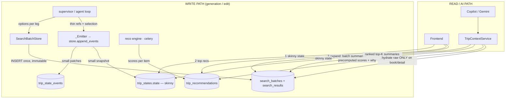

# TravBuddy Persistence Architecture v3 — Trip State / Search Store / AI Retrieval

**Status:** design · **Supersedes:** the single-blob `trip_states.state` model
**Grounded in:** `app/trip_state/{models,store,patch,generator,graph,copilot,agent}.py`,
`app/reco/*`, `schema.sql`, `migrations/2026-07-13_reco_engine.sql`
**Sibling docs:** `docs/trip_graph.md`, `docs/recommendation_engine.md`

---

## v3.1 revisions (review feedback folded in)

Three refinements over v3, each threaded through the sections below:

1. **Results are immutable; personalization is not.** Search results stay INSERT-once, but Copilot
   never mutates them and never spawns a new batch to hide/favorite/re-rank. A **mutable view layer**
   (`trip_result_views`) sits over the immutable results and holds per-item `visible / hidden /
   favorite / selected / score_override / notes`. "Hide this flight", "favourite this hotel" = one
   view-row upsert, not a new search. (§3A)
2. **Durable rules live in memory, not as per-item flags.** "Only refundable from now on", "avoid
   early flights", "rank for comfort instead of price" are *rules*, not edits to today's 88 results —
   flagged rows wouldn't apply to tomorrow's re-search. They go to a per-trip **`trip_memory`** table
   and are applied at query time, so they shape future batches too. (§6B)
3. **`KnowledgeService` is the single façade.** Copilot asks one service for context; underneath sit
   `TripContextService` (state + search + views + reco), `MemoryService` (trip + user memory), and
   pluggable knowledge providers (weather, visa, maps, travel history, community reviews). The AI
   layer stops caring where data comes from. (§6)

Rule of thumb — **view layer = explicit, item-scoped action; memory = durable, declarative rule.**
A broad "remove all Indigo flights" is a rule (memory) that the view layer may *materialize* as hidden
flags on the current batch for instant UI, while the memory rule guarantees it re-applies next search.

---

## 0. The actual defect (not a guess)

The problem is **not** that we lack event sourcing — we already have it. `store.append_events`
appends a `PatchOp` list to `trip_state_events`, applies it to a snapshot in `trip_states.state`,
and CAS-guards on `last_seq`. That machinery is good and we keep it.

The defect is **what the blob contains and how patch values are shaped**:

1. **Triple duplication of search results inside one `jsonb` column.** The same flights/hotels live in:
   - `state.graph.edges[].routes[].hops[].options[]` — each `TransportOption` carries a full
     `raw` provider payload (`graph.py:53-67`), capped at `MAX_OPTIONS_PER_MODE = 15` (`graph.py:46`)
     precisely *because* "storing every raw payload across a 6-leg trip makes the snapshot row enormous."
   - `state.transport.going` / `return_journey` / `onward_segments` — legacy shaped journey blocks
     that **also** embed option lists and hotels (`models.py:51-66`, `generator.py:182-194`).
   - `state.stay.hotels` — the full hotel list again (`models.py:68-70`), plus
     `graph.nodes[].stay.search_results[]` (`graph.py:119-125`).

2. **Every event rewrites whole sections as patch *values*.** The `complete` emit re-sets 9 sections
   (`generator.py:233-241`) and each `PatchOp(op="set", path="/transport", value=<full block>)` puts
   the entire block into the event row's `patches jsonb` **and** into the rewritten snapshot column.
   So a 6-event generation writes ~1.6MB **twice per event** (`trip_state_events.patches` +
   `trip_states.state`), through a TLS path that dies under curl_cffi bursts (`store.py:26-29`,
   `flush.py:31-35`). This is why writes fail and selections vanish on refresh.

**Fix in one sentence:** move immutable search results *out* of the snapshot into an append-only,
content-addressed **search store**; the trip snapshot keeps only decisions + references + the one
selected option denormalized; patch values become small references, not blobs.

Target: snapshot < 150KB, most writes < 20KB, no full-row rewrites, search results written **once**
(INSERT, never rewritten).

---

## 1. Overall architecture



Three stores, three lifecycles:

| Store | Contents | Write pattern | Size |
|---|---|---|---|
| `trip_states` + `trip_state_events` | decisions, references, itinerary text, progress, **selected option denormalized** | small UPDATE + append | < 150KB |
| `search_batches` + `search_results` | every scraped option, `summary` + `raw` | INSERT once, immutable, TTL-expire | grows, never rewritten |
| `trip_recommendations` | precomputed scores/subscores/explanations | UPSERT by reco worker | tiny |

---

## 2. Trip State — what it keeps, what leaves

`TripState` (`models.py`) stays the canonical object but **the `graph`, `transport`, and `stay`
sections stop carrying result lists.** Bump `SCHEMA_VERSION` 1 → 2.

**Keeps (owned decision + reference data):**
- `meta`, `request`, `destination` (thin — name/description/cover/currency, no dumps)
- `costs`, `documents`, `agent_meta`, generation `progress`
- `graph` **slimmed**: nodes keep `days[]` (itinerary text — not large, keep inline), dates, nights,
  and `stay: {batch_id, selected_id, selected_summary}`. Edges keep `{id, from/to, date,
  transport_batch_id, selection, selected_summaries[]}`. **No `options[]`, no `search_results[]`, no `raw`.**

**Leaves (into `search_results`):**
- `edges[].routes[].hops[].options[]` → `search_results` rows (kind=`transport`)
- `nodes[].stay.search_results[]` → `search_results` rows (kind=`hotel`)
- `transport.going/return_journey/onward_segments` full option/hotel lists → **derived at read time**
  by a projection (§9), not stored. `journey_summary`, `outbound_chain`, `waypoints` stay (tiny).

**The one denormalization that fixes "selections disappear on refresh":** the *selected* option's
summary is copied inline into `graph.edges[].selection.selected_summary` (and hotel into
`stay.selected_summary`). Selection becomes a ~1KB durable patch that renders without any join and
**survives batch TTL-expiry** — even if the flight list is re-searched and ids churn, the chosen
flight is still there.

---

## 3. Search store — dedicated result stores

Two levels: a **batch** (one search event) and its **results** (one row per option). One pair of
tables, polymorphic by `kind`, rather than six near-identical tables — same query surface for
transport/hotel/activity/restaurant/weather/visa/events, one `TripContextService`, one index strategy.

```sql
-- One search event: a leg's transport pull, a stop's hotel pull, etc.
CREATE TABLE public.search_batches (
  id           uuid PRIMARY KEY DEFAULT gen_random_uuid(),
  trip_id      uuid NOT NULL REFERENCES public.trip_states(id) ON DELETE CASCADE,
  kind         text NOT NULL,          -- transport | hotel | activity | restaurant | weather | visa | event
  scope_id     text,                   -- leg_id (transport) | stop_id (hotel/activity) | null
  mode         text,                   -- flight|train|bus (transport); null otherwise
  params_hash  text NOT NULL,          -- hash(origin,dest,date,pax,...) — dedup + cache key
  origin       text, destination text, depart_date date,   -- denormalized query, indexable
  status       text NOT NULL DEFAULT 'ready',   -- searching | ready | empty | error
  result_count int NOT NULL DEFAULT 0,
  created_at   timestamptz NOT NULL DEFAULT timezone('utc', now()),
  expires_at   timestamptz             -- prices go stale; refresh past this
);
CREATE INDEX idx_batches_trip   ON public.search_batches (trip_id, kind, scope_id);
CREATE INDEX idx_batches_params ON public.search_batches (params_hash);

-- One bookable option. Thin columns are indexable/rankable in SQL; summary is the AI/UI card;
-- raw is the full provider payload, fetched ONLY on demand.
CREATE TABLE public.search_results (
  id            uuid PRIMARY KEY DEFAULT gen_random_uuid(),
  batch_id      uuid NOT NULL REFERENCES public.search_batches(id) ON DELETE CASCADE,
  trip_id       uuid NOT NULL,          -- denormalized for RLS + direct query
  item_type     text NOT NULL,          -- flight|train|bus|hotel|activity|restaurant
  ext_id        text,                   -- provider id (stable within a batch)
  -- ── thin, indexable projection (Part 8: only useful fields) ──
  operator      text,
  price         numeric,
  currency      text DEFAULT 'INR',
  departs_at    timestamptz,            -- resolved date+time (fixes missing-date issue, §10)
  arrives_at    timestamptz,
  duration_min  int,
  stops         int,
  rating        numeric,
  refundable    boolean,
  -- ── card payload (what the LLM/UI sees) + ground truth (fetched on demand) ──
  summary       jsonb NOT NULL DEFAULT '{}',  -- {name, badges, booking_url, subscores…} ~1-2KB
  raw           jsonb,                        -- full provider dict — NEVER in default SELECT
  created_at    timestamptz NOT NULL DEFAULT timezone('utc', now())
);
CREATE INDEX idx_results_batch      ON public.search_results (batch_id);
CREATE INDEX idx_results_trip_type  ON public.search_results (trip_id, item_type);
CREATE INDEX idx_results_batch_price ON public.search_results (batch_id, price);
CREATE INDEX idx_results_batch_dep   ON public.search_results (batch_id, departs_at);
```

**Immutability & lifecycle.** A batch and its results are written once (`INSERT`), never mutated — so
they never trigger a TOAST/full-row rewrite and never contend on the trip snapshot lock. **Immutable
means the *scraped facts* never change** (price/time/operator as observed at search time — you want
that stable). It does **not** mean the user can't personalize: all mutable, user-specific state lives
in the view layer (§3A), not on the result row. A genuinely *new* search (different params, or past
`expires_at`) creates a new batch; the graph flips its `transport_batch_id` (a tiny patch). Stale
batches are TTL-swept (`expires_at`).

### 3A. View layer — mutable personalization over immutable results

The missing piece from v3. Copilot edits like "hide buses", "favourite this hotel", "bump this one's
score", "add a note" are **not** new searches and **must not** rewrite result rows or spawn batches.
They land in a thin per-`(trip, result)` overlay:

```sql
CREATE TABLE public.trip_result_views (
  trip_id       uuid NOT NULL REFERENCES public.trip_states(id) ON DELETE CASCADE,
  result_id     uuid NOT NULL REFERENCES public.search_results(id) ON DELETE CASCADE,
  visible       boolean,                 -- null = default (visible); false = hidden by user/rule
  favorite      boolean NOT NULL DEFAULT false,
  selected      boolean NOT NULL DEFAULT false,   -- mirrors the graph selection (fast filter)
  score_override real,                   -- manual re-rank ("put this first")
  notes         text,                    -- user annotation ("aunt took this one, loved it")
  source        text NOT NULL DEFAULT 'user',     -- user | copilot | rule:<memory_key>
  updated_at    timestamptz NOT NULL DEFAULT timezone('utc', now()),
  PRIMARY KEY (trip_id, result_id)
);
CREATE INDEX idx_result_views_trip ON public.trip_result_views (trip_id);
```

Reads `LEFT JOIN` the view onto `search_results`, so a result with no view row behaves as the default.
`resolve_options` (§6) applies `COALESCE(v.visible, true)`, `ORDER BY COALESCE(v.score_override,
r.score)`, and can surface `favorite`. This is the **Search Batch (immutable) → Search Results
(immutable) → View Layer (mutable)** split from review feedback.

- **Explicit item action** (`hide THIS`, `favourite THIS`, note) → one `trip_result_views` upsert.
- **Broad rule** (`hide all Indigo`, `only refundable`) → a `trip_memory` rule (§6B). The rule engine
  may *materialize* it as `visible=false, source='rule:no_indigo'` view rows on the current batch for
  instant UI, but the rule is the source of truth and re-applies to the next batch automatically.
- `selected` mirrors the durable graph selection so "show my picks" is one indexed filter; the graph's
  denormalized `selected_summary` remains the render/booking source of truth.

**Relationship to existing tables.** This is distinct from the global `transport_options` flywheel
(`migrations/...:60`, keyed by O/D/date for the price model) — that stays as-is. `search_results` is
*per-trip, per-batch*. Hotels still upsert to the master `hotels` table (identity cache); a
`search_results` hotel row's `summary.hotel_id` points at it. No behavior lost.

**Only-useful-fields (Part 8) is enforced by schema:** thin columns + `summary` are what rank and
render; `raw` is excluded from every list query and hydrated lazily (§8).

---

## 4. Event sourcing — kept, corrected

We already append events + snapshot (`store._append_events_once`). The change is payload, not model:

- **Patch values become references.** `PatchOp(op="set", path="/graph/edges/2/transport_batch_id",
  value="<uuid>")` and `.../selection` with the small `selected_summary`. No section blobs. A typical
  edit is 1–3 small ops → event row < 5KB, snapshot rewrite of a < 150KB doc.
- **Snapshot cadence unchanged** (every event updates `state`) — cheap now that `state` is small, so
  reads never replay the log. Keep `last_seq` CAS, the orphan-replay reconciliation, and the retry/
  flush queue (`store.py`, `flush.py`) verbatim; they now operate on tiny payloads, so the TLS-storm
  failure mode largely disappears (less bytes on the wire, shorter write window).
- **Optional compaction** for very long-lived collaborative trips: keep the last N event rows +
  periodic snapshot; prune older events (they're an audit/undo trail, reconstructable from snapshot).
  Not needed day one — small snapshots already keep loads fast.

**Event taxonomy** (already a free-text `phase`; formalize the vocabulary):
`transport_found · hotel_found · activity_found · user_selected_flight · user_selected_hotel ·
user_selected_activity · budget_updated · preferences_updated · leg_added · trip_completed`.
`_found` events carry only `{batch_id, scope_id}`; `user_selected_*` carry `{selection, selected_summary}`.

---

## 5. Search batch strategy

- **Batch id per search.** `SearchBatchStore.create_batch(trip_id, kind, scope_id, mode, params)` →
  status `searching`; results streamed in with `insert_results(batch_id, rows)`; finalize sets
  `status=ready, result_count, expires_at`.
- **`params_hash` dedup.** Before scraping, look up a live (`expires_at > now`) batch with the same
  `params_hash` for the trip (or globally, for shared O/D/date) → reuse instead of re-scraping. This
  is the cache the current inline model can't have.
- **Scope binding.** Transport batch → `scope_id = leg_id`; hotel batch → `scope_id = stop_id`. The
  graph edge/node stores the `batch_id`. Switching transport (§9) = pick a different `search_results`
  row *within the already-fetched batch* — no planner rerun.
- **Per-mode within one batch.** A leg's flight+train+bus pull is **one** transport batch with mixed
  `item_type` rows, so `resolve_leg_options` can return "all modes ranked" or filter by mode in SQL.

---

## 6. Retrieval layer — KnowledgeService (façade) over TripContextService + MemoryService

Copilot should ask **one** thing for context and stay ignorant of where each fact comes from. So the
retrieval layer is a façade (`KnowledgeService`) over focused providers:

```
              Copilot / agent loop
                      │  build(trip_id, intent, focus)
                      ▼
              ┌─── KnowledgeService ───┐         # single entry point; composes the rest
              │                        │
   TripContextService          MemoryService          KnowledgeProviders (pluggable)
   state + search + views       trip_memory +          weather · visa · maps ·
   + reco (this doc)            user_travel_memory      travel_history · community_reviews
```

**`KnowledgeService.build(trip_id, intent, focus)`** returns the minimal context object (§8/§17): it
loads skinny state + focused ranked options from `TripContextService`, overlays active rules/prefs
from `MemoryService`, and lazily pulls only the providers the intent needs (a visa question doesn't
load hotels). New providers (community reviews, maps) plug in without touching Copilot. This is the
"Copilot asks only KnowledgeService" requirement — the AI layer is decoupled from data sources.

### 6A. TripContextService

`app/trip_state/context.py` — the data-access core under the façade. Replaces
`copilot._state_summary` / `_option_lines` reading the fat `state["transport"]` blocks
(`copilot.py:148-186`) with targeted SQL, now **view-aware and memory-aware**:

```python
class TripContextService:
    def load_state(self, trip_id) -> dict            # skinny trip_states row (1 read)

    def resolve_options(self, trip_id, *, scope_id, kind, mode=None,
                        sort="price", filters=None, rules=None, limit=6) -> list[dict]:
        """SELECT thin cols + summary, r.score, r.explanation, v.favorite, v.notes
           FROM search_results s
           LEFT JOIN trip_result_views v ON (v.trip_id, v.result_id)
           LEFT JOIN trip_recommendations rc ON rc.result_id = s.id
           WHERE s.batch_id = <from graph> AND COALESCE(v.visible, true)
             [AND <memory rules: refundable, no_indigo, …>] [AND item_type=mode]
           ORDER BY COALESCE(v.score_override, <sort|rc.score>) LIMIT n.
           NEVER selects raw."""

    def set_view(self, trip_id, result_id, **fields) -> None   # hide/favorite/score_override/notes
    def hydrate_raw(self, result_ids) -> dict                  # only for booking/detail
```

The agent loop (`agent.py:114 _graph_lines`, `agent.py:295`) and copilot handlers keep their shape;
they source option lines from `KnowledgeService` instead of walking
`state["transport"]["going"]["flights"]`, and new copilot tools `hide_option` / `favorite_option` /
`pin_option` call `set_view`.

### 6B. MemoryService — per-trip conversational memory

The piece v3 lacked. **Per-trip** learned rules/preferences, distinct from the existing **per-user**
`user_travel_memory` (`schema.sql:512`, cross-trip priors distilled by
`services/user_memory.distill_from_trip`). MemoryService merges both: user memory warm-starts a new
trip; trip memory captures what the traveller says *in this trip's* chat.

```sql
CREATE TABLE public.trip_memory (
  trip_id     uuid NOT NULL REFERENCES public.trip_states(id) ON DELETE CASCADE,
  key         text NOT NULL,          -- avoid_early_flights | only_refundable | rank_axis | diet | stay_tier
  value       jsonb NOT NULL,         -- true | {"before":"09:00"} | "comfort" | "vegetarian" | "luxury"
  scope       text,                   -- null (whole trip) | leg_id | stop_id
  confidence  real NOT NULL DEFAULT 0.6,
  source      text NOT NULL DEFAULT 'copilot',   -- copilot | explicit | inferred
  updated_at  timestamptz NOT NULL DEFAULT timezone('utc', now()),
  PRIMARY KEY (trip_id, key, scope)
);
```

Flow for "I don't like early morning flights": Copilot does **not** rerank on the spot — it writes
`trip_memory(avoid_early_flights, {"before":"09:00"}, confidence=0.7)` and confirms. From then on
`KnowledgeService.build` passes that rule into `resolve_options`, so every transport view — this leg
and future re-searches — automatically demotes/filters early departures. "Only refundable from now on"
becomes a durable `only_refundable=true` rule instead of vanishing after one answer. High-confidence,
durable rules graduate into `user_travel_memory` via the existing distiller so the *next trip* starts
warm.

```python
class MemoryService:
    def get(self, trip_id, *, scope=None) -> list[dict]      # active rules, trip ∪ user memory
    def upsert(self, trip_id, key, value, *, scope=None, confidence=0.6, source="copilot")
    def as_query_rules(self, memory) -> dict                 # → filters/sort for resolve_options
```

---

## 7. Recommendation storage — the index

Today ranking is computed on the fly (`reco/rank.py`, `features.py`) every request. Add a
**precomputed index** so chat/render never recompute the heavy features:

```sql
CREATE TABLE public.trip_recommendations (
  trip_id      uuid NOT NULL REFERENCES public.trip_states(id) ON DELETE CASCADE,
  scope_id     text,                    -- leg_id | stop_id
  batch_id     uuid REFERENCES public.search_batches(id) ON DELETE CASCADE,
  result_id    uuid REFERENCES public.search_results(id) ON DELETE CASCADE,
  score        real NOT NULL,
  subscores    jsonb NOT NULL DEFAULT '{}',  -- {persona, budget, comfort, hidden_gem, price_fairness}
  explanation  text,                         -- reco/explain.py output ("₹1,200 under median, refundable")
  signals      jsonb NOT NULL DEFAULT '{}',  -- ranking signals for debug/A-B
  persona      text,                         -- variant the score was computed for
  computed_at  timestamptz NOT NULL DEFAULT timezone('utc', now()),
  PRIMARY KEY (trip_id, result_id, persona)
);
CREATE INDEX idx_trip_recs_scope ON public.trip_recommendations (trip_id, scope_id, score DESC);
```

Written by the reco worker (`reco/rank.py` → new `reco/index.py::RecommendationIndex.upsert_scores`)
right after a batch finalizes — off the hot path, celery, mirroring how `transport_store` and hotel
master persistence already run best-effort. Copilot's "suggest hidden gems / show cheaper flights"
reads this table, it does **not** re-rank.

---

## 8. AI retrieval flow — "show me cheaper flights"

```
user msg ─▶ agent classifies {intent: cheaper_transport, focus_leg: L2}
         ─▶ TripContextService.resolve_options(
                trip_id, scope_id=L2, kind=transport, mode=flight,
                sort="price", filters={max_price: current_selected_fare}, limit=6)
              → SELECT operator, price, departs_at, arrives_at, duration_min, summary,
                       r.score, r.explanation
                FROM search_results s JOIN trip_recommendations r ON r.result_id=s.id
                WHERE s.batch_id = <graph.edges[L2].transport_batch_id>
                  AND s.item_type='flight' AND s.price < <current fare>
                ORDER BY s.price LIMIT 6           -- ~6 rows, no raw, one indexed scan
         ─▶ format 6 lines ─▶ Gemini ─▶ reply + (optional) select_transport_option patch
         ─▶ hydrate_raw([chosen_id]) ONLY when the user books
```

Every copilot capability in Part 11 maps to a `resolve_options` shape:

| Ask | scope | kind/filter | sort |
|---|---|---|---|
| cheaper flights | focus leg | transport, mode=flight, price<sel | price |
| luxury hotels | current stop | hotel, tier=high | score |
| replace this train | focus leg | transport, mode≠train | score |
| stay near the beach | stop | hotel, filter=`summary.landmarks ⊇ beach` | score |
| vegetarian restaurants nearby | stop | restaurant, filter=veg | score |
| hidden gems | stop | hotel/activity, subscores.hidden_gem DESC | subscore |
| how much will I save? | trip | (no batch) compare `selected_summary` vs `resolve_options(...limit=1 min price)` | — |
| move city to Day 4 | — | pure state edit (dates cascade) — no search load | — |
| hide buses / hide this flight | leg | `set_view(visible=false)` (item) or `trip_memory` rule (broad) | — |
| favourite / pin this hotel | stop | `set_view(favorite=true / score_override)` | — |
| only refundable from now on | trip | `trip_memory(only_refundable=true)` — applied every future resolve | — |
| avoid early morning flights | trip | `trip_memory(avoid_early_flights,{before:09:00})` — no immediate rerank | — |

Context sent to Gemini per turn (assembled by `KnowledgeService.build`): skinny state summary (~1KB)
\+ ≤6 **view-filtered, memory-ranked** option summaries (~3KB) + reco explanations (~1KB) + active
memory rules (~0.3KB) ≈ **5KB**, versus today shipping the full 1.6MB state to `_state_summary`.
`resolve_options` already applies the memory rules and view flags, so the model receives an
already-personalized shortlist rather than re-deriving preferences each turn.

---

## 9. Gateway routes & transport switching

Root cause of "Bhiwani → Delhi → Goa exposes one train": the projection ships the *selected* option,
and the fat state made storing all-modes-per-hop expensive (hence `MAX_OPTIONS_PER_MODE`). With the
batch store, **all modes for every hop live in the leg's transport batch** and cost nothing extra in
the snapshot. The frontend switches transport by selecting a different `search_results` row in the
already-loaded batch — the current agent tool `select_transport_option` (`agent.py:372`) just writes
a selection patch; **no planner rerun**.

`resolve_options(scope_id=leg, kind=transport)` with no mode filter returns the ranked union of
train/bus/flight/cab options for that leg. `via_gateway` vs `direct` route candidates
(`graph.py:82-91`) are preserved as a `summary.route_kind` tag on each result so the UI groups them.

---

## 10. Frontend data flow (progressive)

```
GET /api/v2/trips/{id}                 → skinny state (render itinerary, selected picks, dates) — 1 read, <150KB
GET /api/v2/trips/{id}/recommendations → top recs per scope (from trip_recommendations)          — small
   ── user expands a leg / hotel section ──
GET /api/v2/legs/{leg_id}/options?mode=&sort=  → batch summaries (resolve_options)                — paged, no raw
GET /api/v2/results/{id}                → raw detail (hydrate_raw) on click-through / booking
```

Every transport summary row carries the fields Part 10 requires — `departs_at`/`arrives_at` are
resolved `timestamptz` columns, plus `duration_min`, `price`, `operator`, `summary.booking_url` —
so the missing-date bug is structurally impossible (a result without a resolved departure is rejected
at insert, `status=empty`).

---

## 11. Backend API changes

| Endpoint | Change |
|---|---|
| `POST /api/v2/plan` (generation) | emitter writes options → `SearchBatchStore`; state patches carry `batch_id`s + selections (skinny) |
| `GET /api/v2/trips/{id}` | returns skinny state; add `?shape=legacy` that runs the read-time projection (§below) for un-migrated frontends |
| `GET /api/v2/trips/{id}/recommendations` | **new** — reads `trip_recommendations` |
| `GET /api/v2/legs/{leg_id}/options` | **new** — `resolve_options`, paged, no raw |
| `GET /api/v2/results/{id}` | **new** — `hydrate_raw` |
| Copilot `POST …/copilot` | context via `TripContextService.build_copilot_context`, not fat-state summary |

**Backward-compatible read projection.** We already have the fat→shaped logic
(`plan._shape_journey`, `models.trip_state_from_merged`). Repurpose it as a **read-time** projection
`project_legacy(state, batches)` that reconstructs the old `transport.going`/`stay.hotels` shape from
the skinny graph + batch summaries. Old app builds keep working while the frontend migrates; nothing
is stored fat.

---

## 12. Migration plan (Phase 1 → 4)

**Phase 1 — Additive, dual-write (no reads change).**
- Ship `search_batches`, `search_results`, `trip_recommendations` (idempotent migration, RLS below).
- `SearchBatchStore` + `RecommendationIndex` classes.
- Emitter dual-writes: options → batch store **and** still into `state` (unchanged behavior/rollback safety).
- Reco worker starts populating the index. No frontend change. Verify parity offline.

**Phase 2 — Read switch.**
- `TripContextService`; copilot + reco read from it. New progressive endpoints live.
- `?shape=legacy` projection online. Frontend starts consuming skinny state + expand endpoints.

**Phase 3 — Stop storing fat; slim the snapshot.**
- Emitter stops writing `options[]`/`search_results[]`/legacy option lists into `state`
  (keep `selected_summary`). `SCHEMA_VERSION` → 2.
- One-time backfill: for each v1 trip, split `state.graph…options` + `state.stay.hotels` into
  `search_results`, replace with `batch_id`s, denormalize selections, write v2 snapshot. Lazy-migrate
  on read as a fallback for cold trips.

**Phase 4 — Remove duplication + build forward.**
- Drop legacy `transport.going/return_journey/onward_segments` duplication from stored state (kept
  only as projection). Frontend fully on v2. Foundation for collaboration (per-actor events already
  exist) and booking (`bookings`/`expenses` reserved fields, `graph.py:115-116,143-145`).

Roll back at any phase: Phases 1–2 are additive; Phase 3 is gated by `schema_version` so v1 rows
still load via the legacy path.

---

## 13. Backward compatibility strategy

- `schema_version` discriminates v1 (fat) vs v2 (skinny); loader lazy-migrates v1 on read.
- `?shape=legacy` read projection keeps old clients working with zero stored duplication.
- `trip_journey` (classic `/plan`) and `my_trips` mirror unchanged — they read the projection.
- Copilot chat (`copilot_messages`) and `user_travel_memory` untouched.
- Selection semantics preserved: the agent tools (`select_transport_option`, `select_hotel`, …) keep
  their signatures; only their *persistence target* (a small selection patch) changes.

---

## 14. Performance & storage estimates

| Metric | Today | v3 |
|---|---|---|
| Snapshot `state` size | ~1.6MB | 50–150KB |
| Bytes written per generation event | ~1.6MB (snapshot) + up to 1.6MB (event patch) | < 20KB + < 5KB |
| Bytes per generation (~6 events) | ~10–19MB, all rewrites | search: INSERT-once (~300–600KB) + ~6× <25KB snapshot writes |
| Selection edit write | rewrite 1.6MB + CAS | ~1KB patch + 100KB snapshot UPDATE (~16× less) |
| Copilot context to Gemini | full state (1.6MB in, truncated) | ~5KB targeted |
| Option list read | parse 1.6MB blob | indexed `LIMIT 6`, summary-only |

Storage at millions of trips: skinny state ~100KB × N stays lean and fully indexed. `search_results`
is the growth surface — bounded by TTL sweep of expired batches (stale prices are worthless anyway)
and optional monthly partitioning on `created_at`. `raw` is the fat column; keep it out of hot
indexes and consider moving `raw` to object storage (GCS, already in the stack) with a URL in the row
if it ever dominates.

---

## 15. Read/write optimization analysis

- **Writes decoupled.** Search-result INSERTs (immutable, parallelizable across legs, no CAS, no
  rewrite) are separated from the small snapshot UPDATE. A hotel batch landing never rewrites or locks
  the trip snapshot — killing the contention that currently serializes every emit on `_trip_lock`
  through 1.6MB writes.
- **No TOAST rewrite churn.** A 100KB snapshot stays largely inline / cheaply TOASTed; small deltas
  don't rewrite MBs.
- **Reads are index scans with `LIMIT`,** selecting thin columns + `summary`, never `raw`.
- **Progressive loading** means the common render (state + selected picks) is one row; batches load
  only on expand; `raw` only on booking.
- **TLS-storm resilience improves for free:** the failing writes were large; small payloads shorten
  the write window the `bad_record_mac` storms exploit (`flush.py:6-15`). Retry/flush machinery stays
  as belt-and-suspenders.

---

## 16. Risks & trade-offs

| Risk | Mitigation |
|---|---|
| More tables/joins vs one blob read | Skinny state carries `selected_summary` inline → primary render needs **no** join; batches only on expand |
| Referenced batch TTL-expired | Selection is denormalized (survives expiry); re-search creates a new batch + tiny ref patch; existing gateway re-search flow reused |
| Dual-write window drift (Phase 1) | Parity check job compares projected legacy shape vs stored fat state before Phase 3 |
| Backfill correctness on 1.6MB rows | Lazy-migrate-on-read fallback; backfill is idempotent + resumable by `schema_version` |
| Reco index staleness | Recompute on batch finalize + on selection/preference change; `computed_at` gates |
| `raw` bloat in Postgres | Keep out of default SELECT; option to offload to GCS |
| Selection integrity across re-search | `selected_summary` is source of truth for the *chosen* item; ids only needed for booking hydration |
| View/memory/reco ranking conflict | Fixed precedence in `resolve_options`: explicit `score_override` > `visible=false` filter > active memory rules > reco score. One documented order, no ambiguity |
| Memory rule survives re-search but view flags don't | Intentional — rules re-apply to new batches (source of truth); materialized view rows are a cache of a rule on one batch and are rebuilt on re-search from `source='rule:<key>'` |
| Rule explosion / contradictions ("only refundable" then "cheapest") | `trip_memory` PK `(trip_id,key,scope)` upserts — a newer statement on the same key overwrites; `confidence` + `updated_at` break ties; Copilot confirms on conflict |

**Honest trade-off:** we add operational surface (three stores, a projection, a backfill) to buy
lean writes and cheap AI retrieval. Given the failure mode is *lost writes and vanished selections in
production*, that's the right trade — and most of the machinery (event log, CAS, flush queue, graph
model, reco features) already exists and is reused, not rebuilt.

---

## 17. Example JSON schemas

**Skinny TripState (v2) — the `trip_states.state` column:**
```jsonc
{
  "schema_version": 2,
  "meta": { "trip_id": "…", "title": "Goa 5 days", "status": "ready" },
  "request": { "origin": "Bhiwani", "destination": "Goa", "departure_date": "2026-08-01",
               "days": 5, "travelers": 2, "budget_amount": 60000, "interests": ["beach"] },
  "destination": { "name": "Goa", "description": "…", "currency": "INR" },
  "graph": {
    "nodes": [
      { "id": "n_goa", "city": "Goa", "role": "stop", "nights": 4,
        "arrival_date": "2026-08-01", "departure_date": "2026-08-05",
        "days": [ { "day": 1, "activities": [ /* itinerary text — kept inline */ ] } ],
        "stay": { "batch_id": "b_hotel_goa",
                  "selected_id": "r_hotel_42",
                  "selected_summary": { "name": "Taj Holiday Village", "price": 8400,
                                        "rating": 4.6, "booking_url": "…" } } }
    ],
    "edges": [
      { "id": "L1", "from_node_id": "n_bhiwani", "to_node_id": "n_delhi", "date": "2026-08-01",
        "transport_batch_id": "b_txn_L1",
        "selection": { "item_type": "train", "result_id": "r_txn_7",
                       "selected_summary": { "operator": "…", "price": 650,
                                             "departs_at": "2026-08-01T06:10+05:30",
                                             "arrives_at": "2026-08-01T09:40+05:30",
                                             "booking_url": "…" } } }
    ]
  },
  "costs": { "total": 54200, "per_person": 27100 },
  "documents": { "is_international": false },
  "progress": { "phase": "complete", "pct": 100 }
}
```

**`search_batches` + `search_results` row:**
```jsonc
// batch
{ "id": "b_txn_L1", "trip_id": "…", "kind": "transport", "scope_id": "L1",
  "params_hash": "a1b2…", "origin": "Bhiwani", "destination": "Delhi",
  "depart_date": "2026-08-01", "status": "ready", "result_count": 22,
  "expires_at": "2026-07-15T00:00Z" }

// one result (thin cols shown as top-level, card in summary, ground truth in raw)
{ "id": "r_txn_7", "batch_id": "b_txn_L1", "trip_id": "…", "item_type": "train",
  "ext_id": "12456", "operator": "Shatabdi Exp", "price": 650, "currency": "INR",
  "departs_at": "2026-08-01T06:10+05:30", "arrives_at": "2026-08-01T09:40+05:30",
  "duration_min": 210, "stops": 3, "refundable": true,
  "summary": { "name": "Shatabdi Express", "class": "CC", "route_kind": "direct",
               "badges": ["fastest"], "booking_url": "https://…" },
  "raw": { /* full provider payload — fetched only on booking */ } }
```

**`trip_recommendations` row:**
```jsonc
{ "trip_id": "…", "scope_id": "L1", "batch_id": "b_txn_L1", "result_id": "r_txn_7",
  "score": 0.87, "persona": "value-seeker",
  "subscores": { "budget": 0.9, "comfort": 0.8, "price_fairness": 0.95, "hidden_gem": 0.1 },
  "explanation": "₹150 under the median for this route and refundable",
  "computed_at": "2026-07-14T12:00Z" }
```

**`trip_result_views` (view layer) + `trip_memory` rows:**
```jsonc
// view: user favourited one flight, hid a bus, pinned a hotel to the top
{ "trip_id": "…", "result_id": "r_txn_7", "favorite": true, "source": "user" }
{ "trip_id": "…", "result_id": "r_bus_2", "visible": false, "source": "rule:hide_buses" }
{ "trip_id": "…", "result_id": "r_hotel_42", "score_override": 1.0, "notes": "near the beach", "source": "copilot" }

// trip_memory: durable rules learned in chat — applied to every future resolve
{ "trip_id": "…", "key": "only_refundable",     "value": true,               "confidence": 0.9 }
{ "trip_id": "…", "key": "avoid_early_flights", "value": {"before": "09:00"}, "confidence": 0.7 }
{ "trip_id": "…", "key": "rank_axis",           "value": "comfort",          "confidence": 0.6 }
```

**Copilot context object (what `KnowledgeService.build` returns to the agent):**
```jsonc
{ "trip": "Bhiwani → Delhi → Goa · 5 days · 2 pax · ₹60k budget · dep 2026-08-01",
  "selected": { "L1": "Shatabdi CC ₹650", "stay@Goa": "Taj Holiday Village ₹8,400/n" },
  "memory": ["only refundable", "avoid flights before 09:00", "rank by comfort"],
  "focus": { "scope": "L1", "kind": "transport",
             "options": [   // already view-filtered + memory-ranked (comfort, refundable-only)
               { "id": "r_txn_3", "line": "Rajdhani 3A ₹1,100 · 09:10→12:20 · refundable ★fav",
                 "why": "most comfortable, ₹200 over median" },
               { "id": "r_txn_7", "line": "Shatabdi CC ₹650 · 09:40→13:10 · refundable",
                 "why": "cheapest refundable, ₹150 under median" }
             ] } }
```

---

## 18. Suggested folder structure

```
app/trip_state/
  models.py        # TripState v2 (slim graph/transport/stay) — SCHEMA_VERSION=2
  store.py         # snapshot + event log (unchanged mechanics, small payloads)
  patch.py         # unchanged
  graph.py         # graph nodes/edges store batch_ids + selection, not options
  generator.py     # emitter dual-writes → SearchBatchStore, emits ref patches
  batches.py       # NEW — SearchBatchStore
  views.py         # NEW — ViewLayer (trip_result_views: hide/favorite/score_override/notes)
  context.py       # NEW — TripContextService (state + search + views + reco)
  knowledge.py     # NEW — KnowledgeService façade (composes context + memory + providers)
  memory.py        # NEW — MemoryService (trip_memory + user_travel_memory)
  project.py       # NEW — project_legacy(state, batches) for ?shape=legacy
  copilot.py       # sources context from KnowledgeService; new hide/favorite/pin tools → ViewLayer
  agent.py         # tools write selection/view patches (unchanged signatures)
app/reco/
  index.py         # NEW — RecommendationIndex (upsert/load precomputed scores)
  rank.py          # feeds index.py after batch finalize
app/knowledge/     # NEW — pluggable providers behind KnowledgeService
  weather.py  visa.py  maps.py  history.py  reviews.py
app/api/v2/
  trips.py         # GET skinny state (+?shape=legacy), /recommendations
  options.py       # GET /legs/{id}/options, /results/{id}, POST view (hide/favorite)
  memory.py        # GET/PUT /trips/{id}/memory
migrations/
  2026-07-1x_search_store.sql   # search_batches, search_results, trip_result_views,
                                # trip_recommendations, trip_memory, RLS
```

**Service classes:**
- `SearchBatchStore` — `create_batch`, `insert_results`, `finalize`, `find_live(params_hash)`,
  `load_summaries(batch_id, filters, sort, limit)`, `hydrate_raw(result_ids)`.
- `ViewLayer` — `set_view(trip_id, result_id, **fields)`, `apply(trip_id, results)`,
  `materialize_rule(trip_id, batch_id, rule)`.
- `TripContextService` — `load_state`, `resolve_options` (view- + memory-aware), `set_view`, `hydrate_raw`.
- `MemoryService` — `get`, `upsert`, `as_query_rules`.
- `KnowledgeService` — `build(trip_id, intent, focus)`; registry of `KnowledgeProvider`s.
- `RecommendationIndex` — `upsert_scores(trip_id, scope, scored)`, `load_scores(trip_id, scope)`.

**RLS** (mirror existing conventions in `schema.sql:463-504`): `search_batches` / `search_results` /
`trip_result_views` / `trip_recommendations` / `trip_memory` readable when the parent trip is owned or
shared (`EXISTS … trip_states t WHERE t.id = trip_id AND (t.user_id = auth.uid() OR t.visibility IN
('link','public'))`); all writes via service role only. (Note: `trip_result_views` and `trip_memory`
are per-trip and follow the trip's share scope — a collaborator sees shared views/rules, matching the
future-collaboration goal.)

---

## 19. Implementation roadmap

| Phase | Deliverable | Exit criterion |
|---|---|---|
| **1** | Migration (incl. `trip_result_views`, `trip_memory`) + `SearchBatchStore` + `RecommendationIndex`; emitter dual-write; reco index populated | New tables filling; offline parity vs stored fat state passes |
| **2** | `KnowledgeService` + `TripContextService` + `MemoryService` + `ViewLayer`; `project_legacy`; v2 read endpoints; copilot reads via `KnowledgeService`, new hide/favorite/memory tools | Copilot answers all Part-11 asks from < 10KB context; rules persist across turns; `?shape=legacy` byte-parity with old app |
| **3** | Stop storing fat; `SCHEMA_VERSION=2`; backfill + lazy-migrate | Snapshot P95 < 150KB; selection edit write < 20KB; no full-section patches emitted |
| **4** | Drop legacy duplication; pluggable `KnowledgeProvider`s (reviews/maps); frontend fully v2; groundwork for collab + booking | `transport.going` duplication removed; write-failure/lost-selection incidents → 0; new knowledge source added without touching Copilot |

**First PR (smallest safe slice):** the `2026-07-1x_search_store.sql` migration + `SearchBatchStore` +
emitter dual-write behind a flag — additive, reversible, and it immediately starts building the
corpus the rest of the plan reads.
</content>
</invoke>
